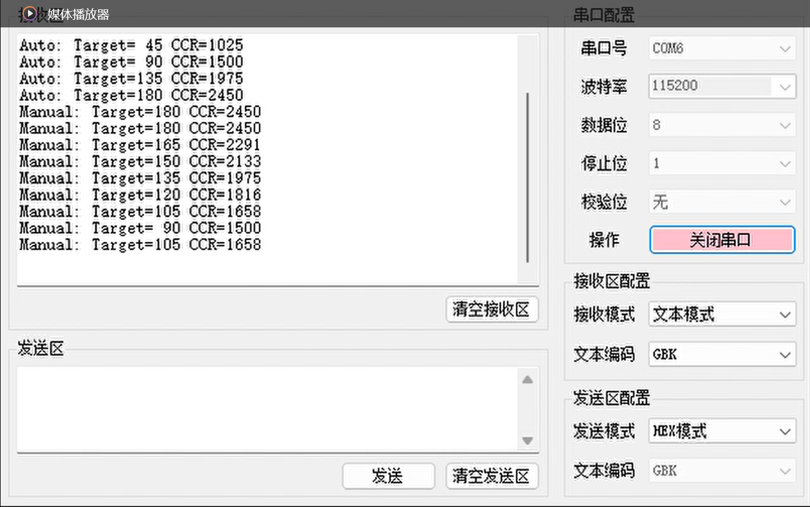

# 第四次培训作业 · PWM 驱动 SG90 舵机

姓名：陈骏泽　学号：20263006503 班级：通信3班

## 一、任务

用 TIM2_CH1 输出 50Hz PWM，驱动 SG90（180°版）转过 0° / 45° / 90° / 135° / 180°。<br>
上电后自动按序列运行一遍，完成后自动切换为按键控制模式（步进 ±15°）。期间 OLED 同步显示“目标角度 / CCR / 脉宽”，串口同步打印。<br>
系统采用非阻塞状态机架构。

## 二、参数推导

- 定时器：TIM2，挂在 APB1 上，实际计数时钟 **72 MHz**
- 让 1 个计数 = 1 µs → PSC = 72 - 1
- 周期 20 ms → ARR = 20000 - 1

验算：

```
72MHz ÷ (71+1) ÷ (19999+1) = 72M ÷ 72 ÷ 20000 = 50 Hz
```

## 三、角度与脉宽

| 角度 | 脉宽 | CCR |
|---|---|---|
| 0° | 550 µs | 550 |
| 45° | 1039 µs | 1039 |
| 90° | 1500 µs | 1500 |
| 135° | 1961 µs | 1961 |
| 180° | 2450 µs | 2450 |

**两端为什么取 550 / 2450：** 名义值是 500 / 2500，实测打满会顶到机械限位、咔咔响，
所以两端各留约 2° 的余量。

## 四、接线

| 信号 | 接到 |
|---|---|
| 舵机 黄（信号） | PA0 |
| 舵机 红（VCC） | 独立 5V 电源 + |
| 舵机 棕（GND） | 独立 5V 电源 −（与板子 GND 相连） |
| OLED SCL / SDA | PB8 / PB9 |
| CH340 TX / RX | PA10 / PA9 |
| KEY_ADD | PB5 - GND （内部上拉） |
| KEY_SUB | PB5 - GND （内部上拉） |


## 五、运行现象

<br>
演示视频：单独提交（见群公告），30 秒内，舵机与 OLED 同画面。<br>

## 六、遇到的问题

### 一、编译问题
问题：疯狂报错fatal error: RTE_Components.h: No such file or directory 和 arm_math.h: No such file or directory。<br>
原因：CubeMX 默认的 CMake 脚本把 Drivers 文件夹里给别的芯片（ARMv8）和给 AI 用的神经网络库（DSP/NN）全吸进来编译了，而我的 GCC 编译器没有 Keil 的专属头文件。<br>
解决：在 CubeMX 的 Project Manager -> Code Generator 中，勾选“Copy only the necessary library files”。<br>

### 二、 硬件与烧录问题
问题：芯片突然锁死，程序烧不进去<br>
原因：在 CubeMX 的 SYS 设置里，误把 Debug 模式选成了 No Debug，导致 PA13 和 PA14 下载引脚变成了普通引脚。<br>
解决：按住板子上的复位键（Reset），点击 CLion 的下载按钮，看到进度条的一瞬间松开复位键，强行把新程序灌进去。<br>

### 三、 串口问题
问题：OLED 和按键正常，但串口助手收不到数据。<br>
原因：重新生成代码时，/* USER CODE BEGIN 0 */ 里的 _write 重定向函数被覆盖丢失了，导致 printf 失效。<br>
解决：补齐 _write 函数。<br>

### 四、 舵机问题
问题：舵机通电后纹丝不动，按按键偶尔抽搐一下<br>
原因：CubeMX 里 TIM2 的定时器参数在来回改动的时候改错了。<br>
解决：把 TIM2 的 PSC 严格改为 72 - 1，ARR 改为 20000 - 1。<br>
